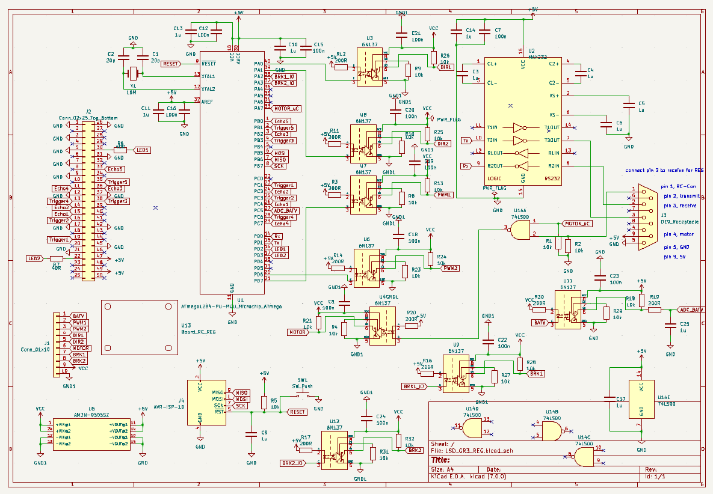
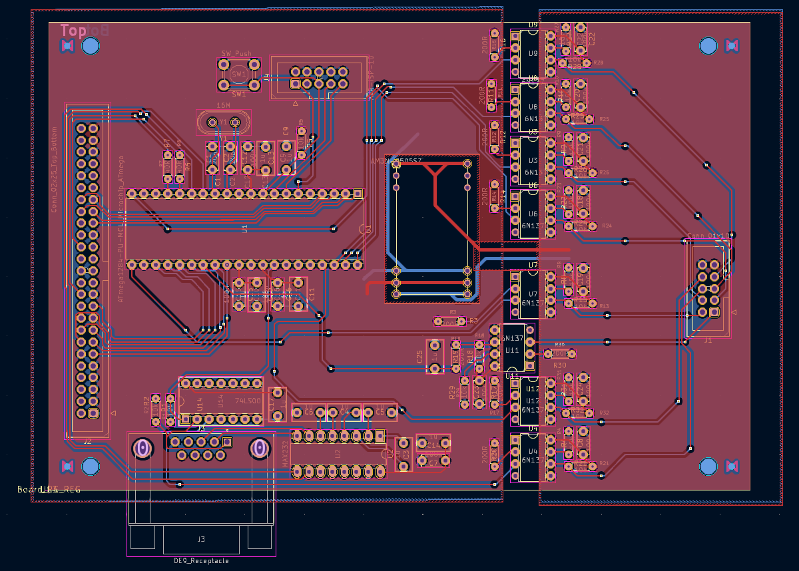
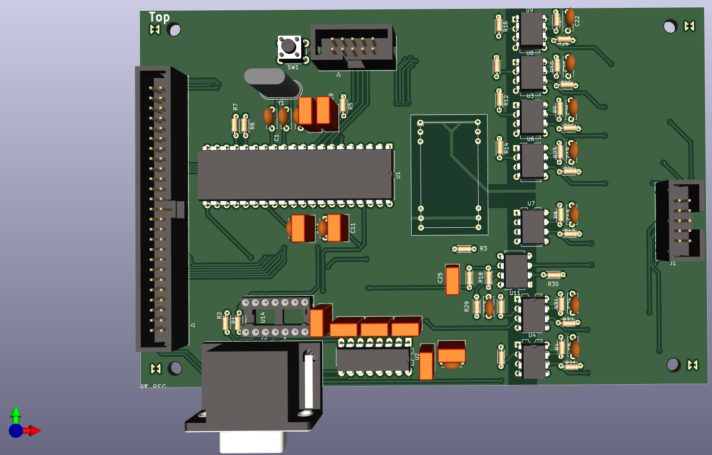
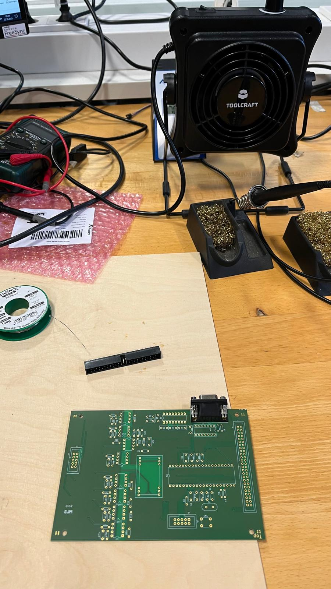
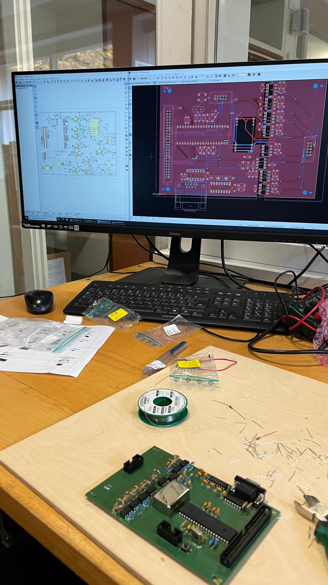
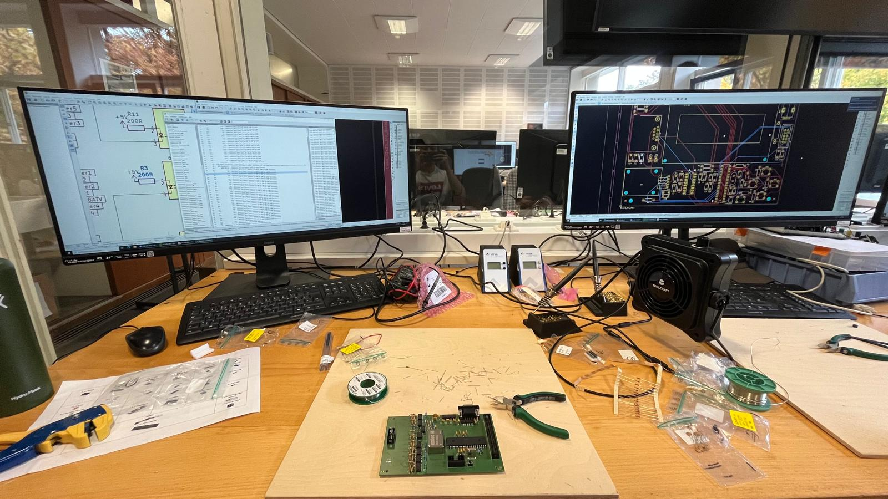

# Laboratory Circuit Design
- Date: 01.10.2024 - 31.03.2025
- Circuit Design Workshop at Institut für Technik der Informationsverarbeitung ([ITIV](https://www.itiv.kit.edu/)) at Karlsruher Institut für Technologie (KIT) 
- [Link to laboratory details](https://www.itiv.kit.edu/60_6308.php)

## Details
Group workshop was for learning PCB design. Team of 3 in charge of designing the power, remote and control PCBs for a Magni robot.

## Highlights
- Designed PCB for control PCB

### 1. Circuit Design & Layout
* Architected schematic logic and routed 2-layer PCB ensuring low-noise return paths and proper trace clearance.
 

  
  <figcaption><b>Figure 1:</b> Complete schematic diagram showing microcontroller pinouts</figcaption>

 

  
  <figcaption><b>Figure 2:</b> Visualisation of 2 layer PCB</figcaption>

 

  
  <figcaption><b>Figure 3:</b> 3D CAD visualization showing final PCB</figcaption>

### 2. Prototyping & Soldering
* Sourced BOM components and hand-assembled the prototype board using temperature-controlled soldering and flux cleaning.
 

<table style="border: none;">
  <tr>
    <td align="center">
       
      <b>Figure 1:</b> 3D PCB before
    </td>
    <td align="center">
       
      <b>Figure 2:</b> 3D PCB after
    </td>
  </tr>
</table>
 

  
  <figcaption><b>Figure 4:</b> Workflow visualisation with teammates</figcaption>

 

### 3. Verification & Bring-Up
* Performed tests and integration with other PCBs and Magni robot

  <a href="https://youtube.com/shorts/cGymUzMkf80">
    
    <figcaption><b>Figure 6:</b> Click to watch video</figcaption>    
  </a>

